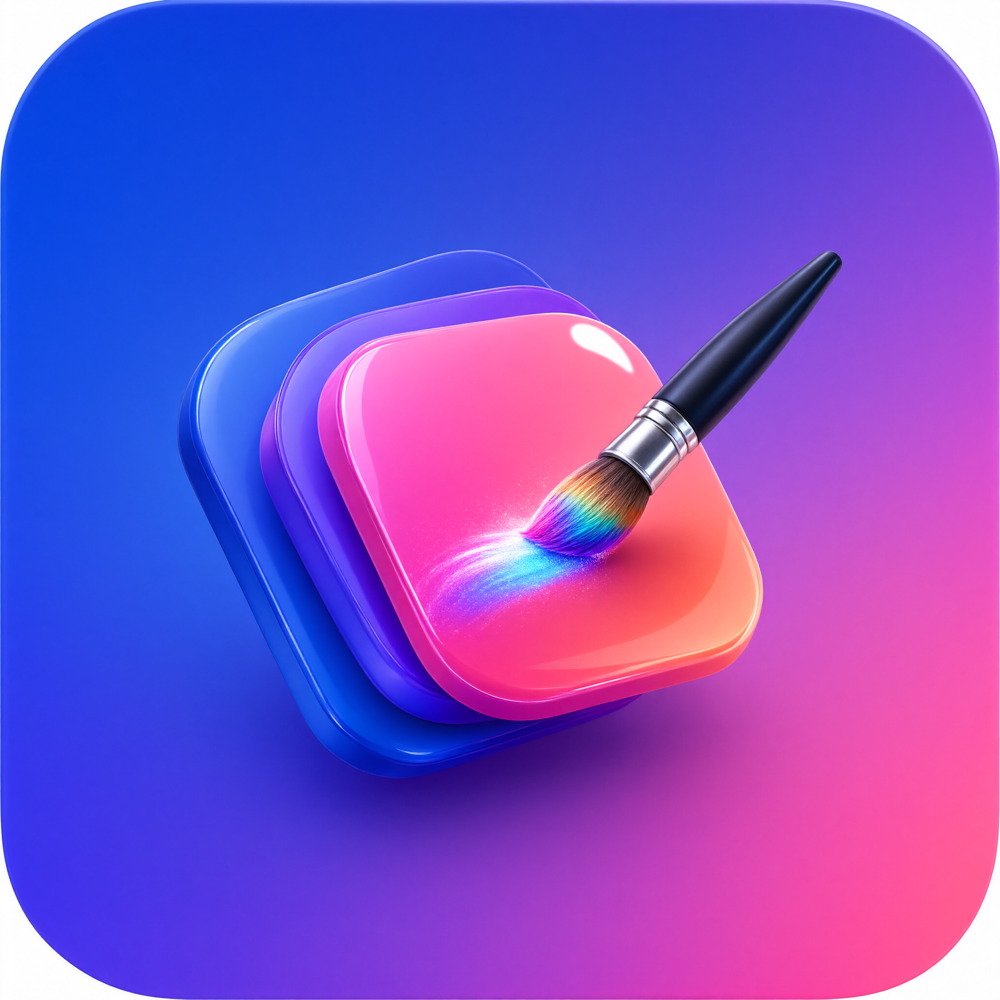
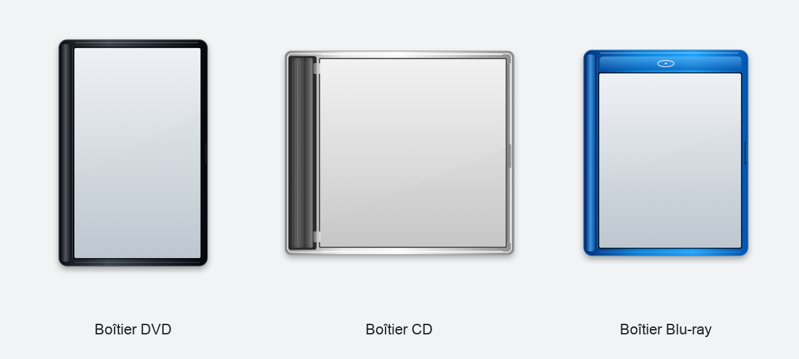
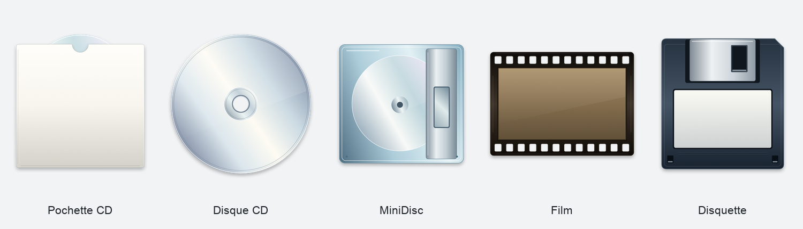

# Create Icons



Application Mac de création d’icônes à partir de photos et d’images, par glisser-déposer.

**Version : 1.0.11 · macOS 14 ou ultérieur · Intel et Apple Silicon**

Réalisation : **Frédéric Fantino**<br>
Contact : [contact@seeview-pro.com](mailto:contact@seeview-pro.com)<br>
2027 — Seeview-pro

## Utilisation

1. Ouvrir **Create Icons.app**.
2. Choisir un style : son aperçu s’affiche en grand avant tout import.
3. Déposer une image dans l’aperçu, ou cliquer sur **Choisir une image**.
4. Ajuster le cadrage et choisir le format.
5. Cliquer sur **Exporter sur le Bureau**.

Chaque export reçoit un nom unique. Le bouton dossier montre le dernier résultat dans le Finder.

## Fonctionnalités

- 37 styles : dossiers, applications, documents, supports de stockage, boîtiers, disques, photos, cartouches, timbre et carte de visite.
- Aperçus disponibles dès l’ouverture et mis à jour avec l’image importée.
- Zoom, position, rotation, miroir, fond, transparence, texte et emoji.
- Suppression locale de l’arrière-plan avec Apple Vision.
- Export individuel, de tous les styles ou de plusieurs images.
- ICNS, PNG, JPG, ICO, dossier personnalisé, iconset, iOS, Android et favicon.
- Application et restauration d’icônes de fichiers et de dossiers.
- Français, anglais, espagnol, allemand et italien.





## Télécharger l’application

[**Télécharger Create Icons 1.0.11 pour Mac**](https://github.com/freddy-micelli-music/create-icons/releases/download/v1.0.11/Create-Icons-1.0.11.zip)

[Voir toutes les releases](https://github.com/freddy-micelli-music/create-icons/releases). Le ZIP « Source code » généré par GitHub contient les sources, pas l’application compilée.

Extraire l’archive puis placer **Create Icons.app** dans le dossier Applications.

Cette version possède une signature locale et n’est pas notariée par Apple. La publication d’une distribution signée Developer ID et notariée nécessitera une configuration supplémentaire.

## Compiler

Installer Xcode et ses outils de développement, puis exécuter depuis le dossier du projet :

```sh
./Build.command
python3 Tools/VerifyRelease.py
```

La compilation produit une application universelle dans `build/Create Icons.app` et une archive dans `build/Create Icons.zip`.

`Package.swift` permet également d’ouvrir les sources dans les outils Swift. Utiliser `Build.command` pour générer l’application complète avec son icône, ses crédits et ses 37 miniatures.

## GitHub

- **Build** compile l’application et vérifie son contenu lors des changements sur `main` et des pull requests.
- **Prepare draft release**, déclenché manuellement dans **Actions**, crée une release en brouillon avec l’application et son empreinte SHA-256.
- La publication finale du brouillon reste manuelle.

Voir [la préparation du dépôt](docs/GITHUB.md), [les instructions de release](docs/RELEASING.md) et [les notes de version](CHANGELOG.md).

## État actuel

Le menu **Vérifier les mises à jour** est préparé. Il ne contacte aucun service pour l’instant : l’adresse du futur service sera configurée séparément.

Les styles sont des dessins propres à Create Icons. Leurs catégories s’inspirent des créateurs d’icônes existants ; le rendu ne reproduit pas exactement Image2icon.

Le détourage dépend de la détection du sujet par Apple Vision. L’export par lot applique les réglages communs aux images d’origine ; le détourage effectué dans l’aperçu concerne l’export de l’image courante. Les exports mobiles couvrent les icônes bitmap classiques, sans export Apple Watch dédié ni jeu complet de calques Android adaptatifs.

## Droits

© 2027 Frédéric Fantino — Seeview-pro. Tous droits réservés. Aucune licence open source n’a été choisie pour ce projet.
